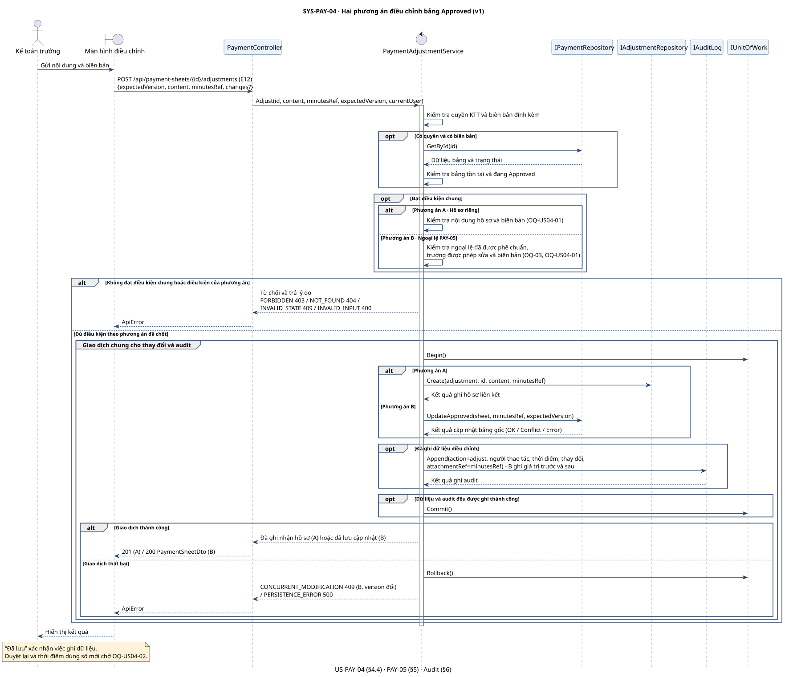

# Đặc tả hệ thống US-PAY-04 (v1)

> Phiên bản: v1 · Ngày nhập: 07/11/2026 · Người phụ trách: Lộc
> Đầu vào: Bộ US-PAY-04 Before Review · [TA-SPEC §4.4, §5 PAY-05, §6](../../../requirements/payment-management/spec.md) · TA-PDF tr.2–3
> AI: Codex · Prompt nhập bản v1: [P-02](../../../workflow/prompt-log.md#p-02--nhập-bộ-us-pay-04-v1)
> Trạng thái: Bản lần chạy đầu – Design Pending Approval
> Bổ sung 09/11/2026: mục "Điểm cần xác nhận" và "Acceptance criteria" do Claude Code / Claude Opus 5.5 soạn theo P-22; phần System Spec giữ nguyên.

## System Spec

| Mục                                | Đặc tả                                                                                                                                                                                                                                                                                                                                                                                                                                                                                                                                                                                                                                                                                                                                                                             |
| ----------------------------------- | ------------------------------------------------------------------------------------------------------------------------------------------------------------------------------------------------------------------------------------------------------------------------------------------------------------------------------------------------------------------------------------------------------------------------------------------------------------------------------------------------------------------------------------------------------------------------------------------------------------------------------------------------------------------------------------------------------------------------------------------------------------------------------------- |
| **Tên Use Case**             | **SYS-PAY-04 — Điều chỉnh bảng thanh toán đã duyệt**                                                                                                                                                                                                                                                                                                                                                                                                                                                                                                                                                                                                                                                                                                                   |
| **Tác nhân**                | Kế toán trưởng (KTT).                                                                                                                                                                                                                                                                                                                                                                                                                                                                                                                                                                                                                                                                                                                                                             |
| **Mục tiêu**                | Ghi nhận việc điều chỉnh sai sót sau khi duyệt, kèm biên bản xác nhận và lịch sử thay đổi.                                                                                                                                                                                                                                                                                                                                                                                                                                                                                                                                                                                                                                                                           |
| **Kích hoạt**               | KTT phát hiện sai sót trên bảng đã duyệt và gửi nội dung điều chỉnh cùng biên bản.                                                                                                                                                                                                                                                                                                                                                                                                                                                                                                                                                                                                                                                                                   |
| **Tiền điều kiện**        | Người thao tác có quyền KTT. Bảng tồn tại và đang ở `Approved`. Có biên bản xác nhận đính kèm.                                                                                                                                                                                                                                                                                                                                                                                                                                                                                                                                                                                                                                                                   |
| **Hậu điều kiện**         | **A:** Hồ sơ điều chỉnh được lưu và liên kết với bảng gốc. Số liệu và trạng thái `Approved` của bảng gốc được giữ nguyên. **B:** Khi đủ điều kiện ngoại lệ, các trường được phép trên bảng gốc được cập nhật và liên kết với biên bản. Cả hai phương án đều ghi audit. Kết quả “đã lưu” chỉ xác nhận việc ghi dữ liệu. Việc duyệt lại, trạng thái của bảng sau khi điều chỉnh theo B và thời điểm kế toán dùng số mới chờ OQ-US04-02.                                                                                                                                                                                                                                         |
| **Dòng cơ bản**            | **1.** KTT chọn bảng và gửi nội dung điều chỉnh cùng biên bản.**2.** Hệ thống kiểm tra quyền KTT, bảng `Approved` và biên bản đính kèm.**3.** Hệ thống kiểm tra theo phương án triển khai đã được chốt. Với **A**, kiểm tra nội dung hồ sơ và biên bản theo tiêu chí sẽ xác nhận ở OQ-US04-01. Với **B**, kiểm tra ngoại lệ PAY-05 đã được phê chuẩn, phạm vi trường được sửa và biên bản theo tiêu chí đã chốt.**4.** Hệ thống lưu hồ sơ liên kết ở A hoặc cập nhật bảng gốc ở B, sau đó ghi audit trong cùng giao dịch.**5.** Khi giao dịch thành công, hệ thống trả kết quả đã ghi nhận hồ sơ (A) hoặc đã lưu cập nhật (B). |
| **Dòng thay thế**           | **2a.** Sai quyền, bảng không tồn tại, bảng chưa `Approved` hoặc thiếu biên bản. Hệ thống từ chối và báo lý do.**3a.** Nội dung hoặc biên bản không đạt tiêu chí đã chốt, hoặc B chưa có ngoại lệ hợp lệ. Hệ thống từ chối và báo lý do.**4a.** Giao dịch thất bại, gồm trường hợp lỗi khi ghi dữ liệu hoặc audit. Hệ thống hoàn tác và báo lỗi.                                                                                                                                                                                                                                                                                                                                                    |
| **Yêu cầu phi chức năng** | **Theo §6:** Ghi audit cho mọi điều chỉnh và mọi thay đổi trạng thái, gồm ai thao tác, lúc nào và thay đổi gì. **Đề xuất kỹ thuật:** Lưu thay đổi và audit trong cùng giao dịch. Với B, ghi giá trị trước và sau cho các trường đã cập nhật.                                                                                                                                                                                                                                                                                                                                                                                                                                                                                   |

## Hai phương án xử lý bảng `Approved`

[GIẢ ĐỊNH – Cần xác nhận] Hai phương án chờ OQ-03. Tiêu chí ghi nhận điều chỉnh và quy trình áp dụng số liệu chờ OQ-US04-01 và OQ-US04-02.

| Phương án                                     | Cách xử lý                                                                                                                                                           | Điều kiện và điểm đánh đổi                                                                                                                                          |
| ------------------------------------------------ | ----------------------------------------------------------------------------------------------------------------------------------------------------------------------- | ----------------------------------------------------------------------------------------------------------------------------------------------------------------------------- |
| **A · Lập hồ sơ điều chỉnh riêng** | `AdjustmentRepository` lưu mã bảng gốc, nội dung điều chỉnh và biên bản trong hồ sơ riêng. Bảng gốc vẫn `Approved` và giữ số liệu đã duyệt. | Tuân thủ PAY-05. Cần chốt tiêu chí chấp nhận hồ sơ và thời điểm dùng số điều chỉnh.                                                                        |
| **B · Sửa bảng gốc theo ngoại lệ**   | `PaymentRepository` cập nhật các trường được phép trên bảng gốc và lưu tham chiếu biên bản. Audit lưu giá trị trước và sau.                    | Cần xác nhận ngoại lệ PAY-05 và giới hạn trường được sửa. Khách hàng cần chốt quy tắc duyệt lại và cách xử lý số liệu đã chuyển sang kế toán. |

Các quyết định còn mở được ghi trong [Điểm cần kiểm tra lại trong đề](open-questions-v1.md).

## Sequence Diagram

`PaymentAdjustmentService` kiểm tra điều kiện và điều phối giao dịch. Hai nhánh A/B biểu diễn hai thiết kế để khách hàng chọn. `AuditRepository` ghi lịch sử cho phương án được triển khai.

[Nguồn PlantUML](../../../design/payment-management/v1/diagrams/seq-us-04-v1.puml)

## Điểm cần xác nhận

Chi tiết (vị trí nguồn, lựa chọn, ảnh hưởng) ở [open-questions-v1.md](open-questions-v1.md).
Tất cả **Cần xác nhận**.

| ID | Loại | Vấn đề | Dùng ở System Spec |
|---|---|---|---|
| OQ-03 | Mâu thuẫn | §4.4 cho KTT điều chỉnh bảng Approved ↔ PAY-05 cấm sửa Approved dưới bất kỳ hình thức nào; chọn A (hồ sơ riêng) hay B (sửa bảng gốc theo ngoại lệ) | Hậu điều kiện, bước 3–5, hai phương án |
| OQ-US04-01 | Thiếu | Tiêu chí chấp nhận biên bản; nội dung/trường được điều chỉnh | Bước 3, 3a |
| OQ-US04-02 | Thiếu | Có duyệt lại không; trạng thái sau điều chỉnh (B); khi nào kế toán dùng số mới | Hậu điều kiện |

## Acceptance criteria

Mã `AC-US04-kk` là mã tự đặt (P-22, AI soạn từ System Spec và TA-SPEC; nhóm chưa duyệt).
Toàn bộ US bị chặn bởi OQ-03 nên không AC nào được coi là đã đáp ứng cho tới khi có xác nhận.

| ID | Given / When / Then | Nhãn | Nguồn | OQ |
|---|---|---|---|---|
| AC-US04-01 | Given người gọi là KTT, bảng `Approved`, có biên bản đạt tiêu chí; When điều chỉnh (bước 1–5); Then điều chỉnh được ghi nhận theo phương án đã chốt và có audit ai/lúc nào/thay đổi gì. | [AC dẫn xuất] | §4.4, §6 | Blocked by OQ-03, OQ-US04-01 |
| AC-US04-02 | Given phương án A được chọn; When điều chỉnh thành công; Then bảng gốc giữ `Approved` và số liệu đã duyệt, hồ sơ điều chỉnh liên kết bảng gốc và biên bản. | [GIẢ ĐỊNH – Cần xác nhận] | §4.4, PAY-05 | Blocked by OQ-03 |
| AC-US04-03 | Given phương án B được chọn và ngoại lệ PAY-05 đã được phê chuẩn; When điều chỉnh thành công; Then chỉ các trường được phép trên bảng gốc thay đổi, audit lưu giá trị trước và sau. | [GIẢ ĐỊNH – Cần xác nhận] | §4.4, PAY-05, §6 | Blocked by OQ-03, OQ-US04-01, OQ-US04-02 |
| AC-US04-04 | Given người gọi không phải KTT; When điều chỉnh; Then từ chối, không ghi dữ liệu (2a). | [ĐẶC TẢ] | §4.4 | – |
| AC-US04-05 | Given bảng không tồn tại hoặc không ở `Approved`; When điều chỉnh; Then từ chối và báo lý do (2a). | [AC dẫn xuất] | §3, §4.4 | – |
| AC-US04-06 | Given không có biên bản xác nhận đính kèm; When điều chỉnh; Then từ chối (2a). | [ĐẶC TẢ] | §4.4 | – |
| AC-US04-07 | Given nội dung hoặc biên bản không đạt tiêu chí, hoặc B chưa có ngoại lệ hợp lệ; When điều chỉnh; Then từ chối và báo lý do (3a). | [AC dẫn xuất] | §4.4, PAY-05 | Blocked by OQ-US04-01, OQ-03 |
| AC-US04-08 | Given lỗi khi ghi dữ liệu hoặc audit; When điều chỉnh; Then hoàn tác toàn bộ, bảng và hồ sơ không đổi, báo lỗi (4a). | [AC dẫn xuất] | §6 | – |
| AC-US04-09 | Given hai yêu cầu điều chỉnh đồng thời trên cùng bảng; When xử lý; Then không ghi đè lẫn nhau, yêu cầu thua nhận lỗi xung đột. | [ĐỀ XUẤT KỸ THUẬT] | §4.4, §6 | – |
| AC-US04-10 | Given điều chỉnh đã ghi nhận; When kế toán/duyệt lại sử dụng số mới; Then theo quy trình được xác nhận. | [GIẢ ĐỊNH – Cần xác nhận] | §1, §4.4 | Blocked by OQ-US04-02 |