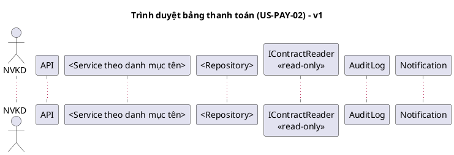

# Skill: sequence-diagram – Sequence theo US/thao tác

Vai trò: **design** – [rules/design.md](../../rules/design.md), điểm vào [AGENTS.md](../../AGENTS.md). Đọc AGENTS.md,
[ngữ cảnh dùng chung](../_shared/payment-context.md) và
[naming-versioning](../naming-versioning/SKILL.md).

## Đầu vào (bước 4 của thứ tự phụ thuộc)

- **Bắt buộc**: `docs/analysis/payment-management/vK/sys-us-NN-vK.md` cùng số US
  và cùng version. Dòng cơ bản/thay thế là khung chính của sequence. Chưa có file
  này thì **không vẽ**, trả lời "Chưa đủ đầu vào: sys-us-NN-vK.md".
- TA-SPEC (đối chiếu), `open-questions-vK.md`.
- Nếu đã có (cùng version): danh mục tên trong `03-detailed-design-vK.md`,
  `class-vK.puml`, `04-api-contract-vK.md` – message phải dùng đúng tên ở đó.
  Chưa có thì ghi bảng "Tên dùng tạm – cần đồng bộ vào 03" trong danh mục sơ đồ.

## Đầu ra

Trong `docs/design/payment-management/vK/diagrams/`, mặc định một file mỗi US:

| File (v1) | Thao tác | US/PAY chính |
|---|---|---|
| `seq-us-01-v1.puml` | Lập bảng (+ sửa Draft) | US-PAY-01; PAY-01, 02, 03; NFR-PAY-02 |
| `seq-us-02-v1.puml` | Trình duyệt | US-PAY-02; PAY-04, 06 |
| `seq-us-03-v1.puml` | Duyệt / từ chối | US-PAY-03; PAY-05, 06, 07, 08 |
| `seq-us-04-v1.puml` | Điều chỉnh Approved | US-PAY-04 ↔ PAY-05 – Blocked by OQ-03 |
| `seq-us-05-v1.puml` | Hủy Draft | US-PAY-05 |

Sơ đồ quá dài thì tách theo thao tác, vd. `seq-us-01-create-v1.puml` +
`seq-us-01-update-v1.puml`, `seq-us-03-approve-v1.puml` + `seq-us-03-reject-v1.puml`
(động từ theo naming-versioning §3). Không đồng thời giữ bản gộp và bản tách.

Ghi danh mục (file, mục đích, US/PAY/AC, OQ, trạng thái kết xuất) trong mục
"Sơ đồ sequence" của `03-detailed-design-vK.md`; chưa có 03 thì tạo mục đó trước
(chỉ mục danh mục). Chỉ vẽ US được giao.

## Khung mỗi file

Lifeline: actor đúng vai trò §2; module ngoài là interface chỉ đọc; không gọi
phương thức ghi tới hợp đồng/bảng giá/sản lượng.

## Nội dung bắt buộc

- **Kiểm tra phía server**: xác thực/vai trò, trạng thái hiện tại, quy tắc PAY –
  mỗi kiểm tra là một `alt` có nhánh lỗi trả mã HTTP/mã lỗi khớp `04-api-contract-vK.md`
  (chưa có 04 thì ghi mã lỗi tạm và đưa vào bảng tên tạm).
- **Transaction**: `group Transaction` bao đổi trạng thái + ghi audit; nhánh
  `else lỗi lưu/audit` → rollback, trạng thái giữ nguyên (NFR-PAY-01).
- **Chống trình trùng (PAY-04)** ở submit: thể hiện cơ chế đã chọn trong
  `07-design-decisions-vK.md` (Idempotency-Key, kiểm tra trạng thái có điều kiện/
  version, unique constraint…) gồm nhánh request lặp và hai request đồng thời.
  Chưa có DD thì ghi note `[ĐỀ XUẤT KỸ THUẬT]` + DD cần lập, không coi là đã chốt.
- **Cấm tự duyệt (PAY-07)** ở approve/reject: `alt actor là người lập` → từ chối;
  định nghĩa "người lập" dẫn OQ trong `sys-us-03-vK.md` nếu BA đã nêu.
- **Ngưỡng tiền (PAY-06)**: guard ghi `Blocked by OQ-02`, không viết so sánh đã chốt.
- **Reject**: lý do bắt buộc (PAY-08); trạng thái đích vẽ `alt` hai phương án
  với note `Blocked by OQ-04`.
- **Adjust**: toàn bộ sơ đồ gắn banner `Blocked by OQ-03`; nếu vẽ phương án
  (sửa trực tiếp / bản điều chỉnh) thì mỗi phương án một `alt` có nhãn giả định;
  có biên bản đính kèm và audit trước/sau.
- **Create**: `loop` sinh dòng từ sản lượng × đơn giá tại thời điểm tính (PAY-03);
  kiểm tra Active/bảng giá/đối soát (PAY-01, 02); kiểm tra trùng kỳ
  `Blocked by OQ-01`; note NFR-PAY-02 là mục tiêu, chưa đo.
- **Thông báo**: chỉ ở submit theo §4.2; kênh và các thông báo khác → `opt` + OQ.
- Mọi message đổi trạng thái kết thúc bằng ghi audit (ai, lúc nào, trước/sau).

## Kiểm chứng

- Mỗi dòng thay thế trong `sys-us-NN-vK.md` có một nhánh `alt/else` tương ứng
  (ghi bảng đối chiếu bước SYS ↔ đoạn sequence trong danh mục).
- Tên message = tên method/endpoint/event ở class, API, state machine cùng version.
- `@startuml`/`@enduml` cân bằng, tên sau `@startuml` = tên file; kết xuất theo
  mục 7 ngữ cảnh dùng chung hoặc ghi `Chưa kiểm tra kết xuất sơ đồ`.
- Ghi prompt-log; không sửa `src/`.
