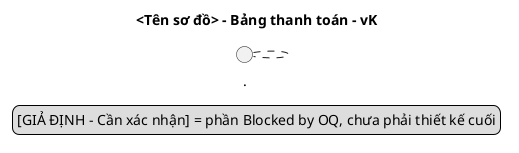

# Skill: uml-diagrams – Component, class, state machine

Vai trò: **design** – [rules/design.md](../../rules/design.md), điểm vào [AGENTS.md](../../AGENTS.md). Đọc AGENTS.md,
[ngữ cảnh dùng chung](../_shared/payment-context.md) và
[naming-versioning](../naming-versioning/SKILL.md). Sequence dùng skill
[sequence-diagram](../sequence-diagram/SKILL.md).

## Đầu vào (bước 5–6 của thứ tự phụ thuộc)

- Cùng version vK: `sys-us-*-vK.md`, `open-questions-vK.md` và các `seq-us-*-vK.puml`.
  Thiếu sequence của US nào thì ghi "Chưa đủ đầu vào: seq-us-NN-vK.puml" và
  không vẽ phần thuộc US đó như đã có căn cứ.
- `03-detailed-design-vK.md` mục "Danh mục tên dùng chung" (nếu có) và các `.puml`
  đã có trong `vK/diagrams/` – cập nhật, không tạo bản trùng.
- Đọc lại `src/Qtkd.Api/` trước khi vẽ thành phần AS-IS.

## Đầu ra

Trong `docs/design/payment-management/vK/diagrams/`: `component-vK.puml` (bước 5,
đi với `02-architecture-design-vK.md`), `class-vK.puml` và `state-machine-vK.puml`
(bước 6, đi với `03-detailed-design-vK.md`); tùy chọn `use-case-vK.puml`,
`activity-<thao-tac>-vK.puml`. ERD do skill [data-design](../data-design/SKILL.md).
Cập nhật danh mục sơ đồ trong 03 (hoặc 02 cho component): tên file, mục đích,
phạm vi, US/PAY, trạng thái kết xuất.

## Khung bắt buộc mỗi file

## State machine (`state-machine-vK.puml`)

- Chỉ 5 trạng thái §3: `Draft`, `PendingApproval`, `Approved`, `Rejected`, `Cancelled`.
  Không thêm trạng thái (vd. Adjusted, Submitted, Deleted).
- Mỗi chuyển: `Nguồn --> Đích : event [guard] / action`, event trùng tên thao tác
  (`create/update/submit/approve/reject/adjust/cancel`) trong danh mục tên.
- Chuyển có căn cứ rõ: `[*] --> Draft` (US-PAY-01), `Draft --> PendingApproval`
  (US-PAY-02, guard PAY-04), `PendingApproval --> Approved` (US-PAY-03, guard PAY-06/07),
  `Draft --> Cancelled` (§3, US-PAY-05), `Cancelled --> [*]`.
- Phần mâu thuẫn vẽ **cả hai phương án** với nét đứt/màu và note
  `Blocked by OQ-…`, không chọn: từ chối → `Rejected` (§3) vs → `Draft` (PAY-08)
  (`OQ-04`); thoát khỏi `Rejected`; điều chỉnh trên `Approved` (§4.4 ↔ PAY-05, `OQ-03`).
- Mọi action đổi trạng thái có `/ ghi audit` (NFR-PAY-01).
- Guard ngưỡng tiền ghi `Blocked by OQ-02`, không viết `>= 500tr` hoặc `> 500tr` như đã chốt.
- Mỗi transition phải khớp một message đổi trạng thái trong `seq-us-*-vK.puml`.

## Class (`class-vK.puml`)

- Lớp miền + service + interface; mỗi thuộc tính/phương thức có visibility
  (`+ - # ~`) và kiểu; quan hệ có multiplicity hai đầu (`"1" *-- "1..*"`).
- Composition cho bảng ↔ dòng; association có hướng tới audit; dependency
  (`..>`) tới interface đọc module khác.
- Module ngoài (hợp đồng, bảng giá, sản lượng) chỉ là `interface` chỉ đọc
  trong package riêng `<<external, read-only>>`; không vẽ phương thức ghi.
- Enum trạng thái đúng 5 giá trị §3. Không thêm lớp/abstraction không phục vụ
  US/PAY (vd. generic repository, plugin, cấu hình ngưỡng động) trừ khi có DD-kk.
- Thuộc tính phụ thuộc OQ (đơn vị kỳ, VAT, làm tròn, người được coi là "người lập")
  gắn note `Blocked by OQ-…`.
- Mỗi phương thức public của service ánh xạ một thao tác/endpoint trong danh mục
  tên và xuất hiện trong ít nhất một sequence.

## Component (`component-vK.puml`)

- Ranh giới module Bảng thanh toán là `package`/`component`; giao diện cung cấp
  `()` và phụ thuộc `..>` tới interface đọc của Hợp đồng/Bảng giá/Sản lượng.
- Thể hiện thành phần audit, thông báo (kênh chưa rõ → note OQ), lưu trữ, xác thực.
- Đánh dấu `<<AS-IS>>` cho thành phần có thật trong `src/Qtkd.Api/` (đã đọc file),
  `<<TO-BE>>` cho thành phần đề xuất. Không vẽ thứ AS-IS chưa có như đã tồn tại.
- Mỗi participant trong sequence cùng version thuộc một component.

## Use case / activity (chỉ khi cần)

Actor đúng 3 vai trò §2; use case đúng phạm vi §1 (không vẽ CRUD hợp đồng/bảng giá).

## Kiểm chứng

1. Chéo tên: mọi state/event/class/method xuất hiện trong danh mục tên;
   so với sequence, `04-api-contract-vK.md`, `05-data-design-vK.md` cùng version.
2. `grep -c "@startuml" vK/diagrams/*.puml` = `grep -c "@enduml"`; mỗi file có `title`.
3. Kết xuất theo mục 7 của ngữ cảnh dùng chung; ghi lệnh + kết quả, hoặc
   `Chưa kiểm tra kết xuất sơ đồ`.
4. Ghi trạng thái `Design Pending Approval`; ghi prompt-log. Không sửa `src/`.
